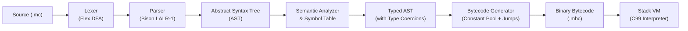

# Mini-C Bytecode Compiler and Portable Stack Virtual Machine (`minic-vm`)

- **Author:** Md. Sharafat Karim (ID: 2102024, Reg: 10151)
- **Course:** CIT-412 (Compiler Design & Automata Theory Sessional)
- **Target Platforms:** GNU/Linux & Android (via Termux / POSIX C99)

---

## 1. Project Overview & Architecture

`minic-vm` is a complete, modular, multi-pass compiler and virtual machine runtime for a structured imperative C-subset language (**Mini-C**). 

The system implements the full compilation pipeline:


The toolchain consists of two standalone C99 binaries:
1. **`minic` (Compiler Driver):** Parses source code, performs semantic type checks, emits binary `.mbc` files, and provides multi-stage visualization flags.
2. **`minic-vm` (Virtual Machine Runtime):** A zero-dependency, deterministic stack-based interpreter that executes compiled `.mbc` bytecode with optional step-by-step stack tracing.

---

## 2. Language Specification

### 2.1 Supported Data Types
Mini-C supports two primitive value types and a function return type:

| Data Type | Internal VM Representation | Semantics |
| :--- | :--- | :--- |
| `int` | 64-bit signed integer (`int64_t`) | Two's complement integer arithmetic |
| `float` | 64-bit IEEE-754 double precision (`double`) | Floating-point calculations |
| `void` | None | Used for function returns without values |

#### Type Coercion & Promotion Rules:
- **Implicit Promotion (`int` $\rightarrow$ `float`):** When an `int` and a `float` participate in a binary operation (e.g. `10 + 2.5`), the compiler automatically promotes the integer to floating-point by inserting an `AST_CAST_I2F` node (`I2F` bytecode instruction). The resulting operation evaluates in floating-point.
- **Assignment Promotion:** Assigning an `int` expression to a `float` variable (e.g. `float f = 10;`) automatically promotes the value to `10.0`.
- **Type Safety Gate:** Assigning a `float` expression to an `int` variable (e.g. `int a = 3.14;`) is statically rejected at compile-time as a semantic type error.

---

### 2.2 Identifier Naming Rules
Identifiers follow the standard C lexical definition:

$$\text{Identifier} \rightarrow [a\text{-}zA\text{-}Z\_][a\text{-}zA\text{-}Z0\text{-}9\_]^*$$

- Must begin with an alphabetical letter (`a-z`, `A-Z`) or an underscore (`_`).
- Can be followed by any sequence of letters, digits (`0-9`), or underscores.
- **Case-sensitive:** `total`, `Total`, and `TOTAL` represent three distinct identifiers.
- **Length:** Arbitrary length supported.
- Cannot conflict with reserved keywords.

---

### 2.3 Reserved Keywords & Tokens

| Category | Keywords / Tokens | Description |
| :--- | :--- | :--- |
| **Data Types** | `int`, `float` | Variable and return type specifiers |
| **Control Flow** | `if`, `else`, `while`, `return` | Branching, looping, and function exit |
| **Built-in I/O** | `print`, `println` | Built-in print primitives for numeric output |
| **Arithmetic Operators** | `+`, `-`, `*`, `/` | Addition, subtraction, multiplication, division |
| **Relational Operators** | `==`, `!=`, `<`, `>`, `<=`, `>=` | Equality and relational comparisons |
| **Logical / Unary** | `!`, `-` (unary negation) | Logical NOT (tests equality to 0), arithmetic negation |
| **Delimiters** | `(`, `)`, `{`, `}`, `;`, `=` | Grouping, blocks, statements, and assignment |

---

### 2.4 Comments & Whitespace
- **Single-line comments:** `// comment text` (ignored up to newline)
- **Multi-line comments:** `/* comment text */` (nesting not supported, properly updates line/column numbers)
- **Whitespace:** Space, tab, carriage return, and newline are skipped by the scanner while maintaining tracking coordinates.

---

## 3. Parsing Methodology & Formal Grammar

### 3.1 Parsing Algorithm: Bottom-Up LALR(1)
The syntactic analyzer uses **GNU Bison** configured for **LALR(1)** (Look-Ahead LR with 1 token of lookahead).

#### Bottom-Up vs. Top-Down:
- **What is NOT used:** This compiler does **NOT** use top-down parsing (such as LL(1), Recursive Descent, or Leftmost Derivation $S \Rightarrow_{lm}^* w$). Top-down parsers predict productions from the root non-terminal down to the leaves and cannot easily handle left-recursive grammar rules without transformation.
- **What IS used:** Mini-C uses **Bottom-Up Shift-Reduce Parsing** based on **Rightmost Derivation in Reverse** ($S \Rightarrow_{rm}^* \alpha$).
  - Tokens are shifted onto the parser stack until a sequence matches the right-hand side of a production rule.
  - The sequence is then **reduced** to the corresponding non-terminal.
  - The Abstract Syntax Tree (AST) is constructed bottom-up from leaf nodes toward the root.

```mermaid
flowchart TD
    subgraph Bottom-Up Parsing (LALR-1)
        direction TB
        T["Tokens: [ int , a , = , 5 , ; ]"] --> S["Shift onto Parser Stack"]
        S --> R["Reduce Handle (Reverse Rightmost Derivation)"]
        R --> B["Build AST Sub-tree Nodes"]
        B --> P["Accept: Root Program Node"]
    end
```

### 3.2 Operator Precedence & Conflict Resolution
The grammar uses Bison precedence declarations to resolve operator associativity and eliminate the classic **dangling-else ambiguity**:

| Level | Associativity | Operators | Description |
| :--- | :--- | :--- | :--- |
| 1 (Lowest) | Non-associative | `LOWER_THAN_ELSE` | Forces `if` without `else` to reduce only when no `else` follows |
| 2 | Non-associative | `ELSE` | Gives `else` higher precedence so it shifts to the innermost `if` |
| 3 | Left | `==`, `!=` | Equality comparisons |
| 4 | Left | `<`, `>`, `<=`, `>=` | Relational ordering |
| 5 | Left | `+`, `-` | Addition and subtraction |
| 6 | Left | `*`, `/` | Multiplication and division |
| 7 (Highest) | Right | `!`, `UMINUS` (`-`) | Logical NOT and unary negation |

### 3.3 Context-Free Grammar (BNF Summary)
```bnf
program       ::= func_def

func_def      ::= type_spec IDENTIFIER '(' ')' block

block         ::= '{' stmt_list '}'

stmt_list     ::= /* empty */
                | stmt_list stmt

stmt          ::= decl_stmt
                | assign_stmt
                | if_stmt
                | while_stmt
                | return_stmt
                | print_stmt
                | block
                | ';'

decl_stmt     ::= type_spec IDENTIFIER ';'
                | type_spec IDENTIFIER '=' expr ';'

assign_stmt   ::= IDENTIFIER '=' expr ';'

if_stmt       ::= IF '(' expr ')' stmt
                | IF '(' expr ')' stmt ELSE stmt

while_stmt    ::= WHILE '(' expr ')' stmt

return_stmt   ::= RETURN expr ';'
                | RETURN ';'

print_stmt    ::= PRINT '(' expr ')' ';'
                | PRINTLN '(' expr ')' ';'

expr          ::= expr '+' expr
                | expr '-' expr
                | expr '*' expr
                | expr '/' expr
                | expr '==' expr
                | expr '!=' expr
                | expr '<' expr
                | expr '>' expr
                | expr '<=' expr
                | expr '>=' expr
                | '-' expr
                | '!' expr
                | '(' expr ')'
                | IDENTIFIER
                | NUM_INT
                | NUM_FLOAT
```

---

## 4. Semantic Analysis & Scoped Symbol Table

### 4.1 Scope Tree Hierarchy
The compiler maintains a dynamic tree of scopes (`Scope` struct linked via `parent` pointers):
- Entering a block `{` pushes a child scope (`depth = parent->depth + 1`).
- Exiting a block `}` returns to the parent scope.
- **Lookup:** Variable resolution searches from the innermost active scope outward to the global scope.
- **Shadowing:** Inner scopes may shadow variables declared in enclosing outer scopes.
- **Duplicate Declaration Detection:** Declaring the same variable twice within the identical scope depth triggers a semantic error.
- **Local Slot Allocation:** Each unique variable is assigned a zero-indexed local slot (`0, 1, 2, ...`) mapped directly to the virtual machine's local register table.

### 4.2 Compile-Time Diagnostics
Errors report accurate source line and column numbers:
```text
Semantic Error [4:5]: undeclared variable 'total'
Semantic Error [6:9]: duplicate declaration of variable in same scope 'x'
Semantic Error [8:7]: cannot assign float expression to int variable 'counter'
```

---

## 5. Bytecode Architecture & VM Instruction Set

### 5.1 Portable Binary Bytecode Format (`.mbc`)
Compiled bytecode is written as a compact 24-byte header followed by the constant pool and the raw instruction stream:

```text
+--------------------------------------------------------------+
|                    24-Byte File Header                       |
+--------------------------------------------------------------+
| 0x00 - 0x03 : Magic Signature ("\x7fMBC")                    |
| 0x04 - 0x05 : Version (0x0001)                               |
| 0x06 - 0x07 : Flags (0x0000)                                 |
| 0x08 - 0x0B : Constant Pool Entry Count (uint32_t)           |
| 0x0C - 0x0F : Code Stream Length in Bytes (uint32_t)         |
| 0x10 - 0x13 : Total Local Variable Slot Count (uint32_t)     |
| 0x14 - 0x17 : Entry Point Byte Offset (uint32_t)             |
+--------------------------------------------------------------+
|                       Constant Pool                          |
+--------------------------------------------------------------+
| [Tag: 0x01 (Float)] [8-Byte IEEE-754 double value] ...       |
+--------------------------------------------------------------+
|                    Instruction Code Stream                   |
+--------------------------------------------------------------+
| [Opcode] [Operands...]                                       |
+--------------------------------------------------------------+
```

### 5.2 Instruction Set Architecture (ISA)

| Opcode | Mnemonic | Operands | Description |
| :---: | :--- | :--- | :--- |
| `0x00` | `NOP` | None | No operation |
| `0x01` | `POP` | None | Discard top of stack |
| `0x02` | `PUSH_I` | `int64_t` (8 bytes) | Push 64-bit immediate integer |
| `0x03` | `PUSH_CONST` | `uint16_t` (2 bytes) | Push constant from constant pool |
| `0x04` | `LOAD_LOCAL` | `uint16_t` (2 bytes) | Push value from local variable slot |
| `0x05` | `STORE_LOCAL`| `uint16_t` (2 bytes) | Pop value and store into local variable slot |
| `0x10` | `ADD_I` | None | Integer addition |
| `0x11` | `SUB_I` | None | Integer subtraction |
| `0x12` | `MUL_I` | None | Integer multiplication |
| `0x13` | `DIV_I` | None | Integer division (dynamic zero-division trap $\rightarrow$ exit code 2) |
| `0x14` | `NEG_I` | None | Integer negation |
| `0x20` | `ADD_F` | None | Floating-point addition |
| `0x21` | `SUB_F` | None | Floating-point subtraction |
| `0x22` | `MUL_F` | None | Floating-point multiplication |
| `0x23` | `DIV_F` | None | Floating-point division (dynamic zero-division trap $\rightarrow$ exit code 2) |
| `0x24` | `NEG_F` | None | Floating-point negation |
| `0x30` | `I2F` | None | Convert top of stack integer to float |
| `0x31` | `F2I` | None | Convert top of stack float to integer |
| `0x40` | `CMP_EQ_I` | None | Integer equality comparison (pushes 1 or 0) |
| `0x41` | `CMP_NE_I` | None | Integer inequality comparison |
| `0x42` | `CMP_LT_I` | None | Integer less-than comparison |
| `0x43` | `CMP_GT_I` | None | Integer greater-than comparison |
| `0x44` | `CMP_LE_I` | None | Integer less-than-or-equal comparison |
| `0x45` | `CMP_GE_I` | None | Integer greater-than-or-equal comparison |
| `0x50` - `0x55` | `CMP_*_F` | None | Floating-point relational comparisons |
| `0x60` | `JMP` | `int32_t` (4 bytes) | Unconditional relative jump |
| `0x61` | `JZ` | `int32_t` (4 bytes) | Jump if top of stack is 0 (false) |
| `0x62` | `JNZ` | `int32_t` (4 bytes) | Jump if top of stack is non-zero (true) |
| `0x70` | `PRINT_I` | None | Pop and display integer to stdout |
| `0x71` | `PRINT_F` | None | Pop and display float to stdout |
| `0x72` | `PRINT_NL` | None | Print newline `\n` to stdout |
| `0xFF` | `HALT` | None | Halt VM and return top of stack as process exit code |

---

## 6. Stack Virtual Machine Runtime (`minic-vm`)

The virtual machine is written in strict **ISO C99** with zero external dependencies.

- **Operand Stack:** 1024 slots storing 64-bit polymorphic `Value` unions (`int64_t` or `double`).
- **Memory Safety:** Checks bounds on every push and pop; traps stack underflow and overflow.
- **Divide-by-Zero Handling:** Checked dynamically in `DIV_I` and `DIV_F`. If a divisor equals zero, the VM outputs `Runtime Error: Division by zero` to `stderr` and terminates cleanly with exit code **2**.
- **Trace Mode:** Outputs the program counter (PC), disassembled instruction, operands, and stack contents before each execution step.

---

## 7. CLI Reference & Multi-Stage Visualization

### Building the Project
```bash
cd src
make clean && make all
```

### Visualizing Every Compiler Stage
To visualize the entire pipeline from source to VM execution:
```bash
./bin/minic run --verbose <file.mc>
```

### Individual Inspection Commands
```bash
# 1. Print the parsed Abstract Syntax Tree (AST)
./bin/minic --dump-ast <file.mc>

# 2. Print Scoped Symbol Table (scopes, variables, and slots)
./bin/minic --dump-sym <file.mc>

# 3. Print Typed AST (with semantic types and Cast I2F nodes)
./bin/minic --dump-typed-ast <file.mc>

# 4. Disassemble bytecode without running
./bin/minic --disasm <file.mc>
# or disassemble an existing .mbc binary file:
./bin/minic-vm --disasm <file.mbc>

# 5. Compile source to .mbc file
./bin/minic compile <file.mc> -o <file.mbc>

# 6. Run compiled bytecode with step-by-step stack trace
./bin/minic-vm --trace <file.mbc>

# 7. Pipe source code directly from stdin
./bin/minic --dump-ast - << 'EOF'
int main() {
    int x = 42;
    println(x);
    return 0;
}
EOF
```

---

## 8. Cross-Platform Compatibility (GNU/Linux & Android)

- **GNU/Linux:** Compiles out-of-the-box using GCC or Clang (`make all`).
- **Android (via Termux):**
  1. Install packages inside Termux:
     ```bash
     pkg update && pkg install clang make flex bison
     ```
  2. Run `make all`.
  3. Portable `.mbc` files compiled on Linux run unchanged on Android Termux.

---

## 9. Automated Testing
Run the comprehensive regression suite:
```bash
make test
```
The suite verifies:
1. Arithmetic precedence & mixed-type arithmetic (`01_arithmetic.mc`)
2. Multi-variable assignment & implicit promotion (`02_variables.mc`)
3. Conditional branching & while loop accumulation (`03_control_flow.mc`)
4. Scoped blocks and variable shadowing (`04_scoping.mc`)
5. Semantic rejection of invalid assignment float $\rightarrow$ int (`05_errors.mc`)
6. Dynamic runtime division-by-zero exit code 2
7. Multi-stage CLI visualizer flags
